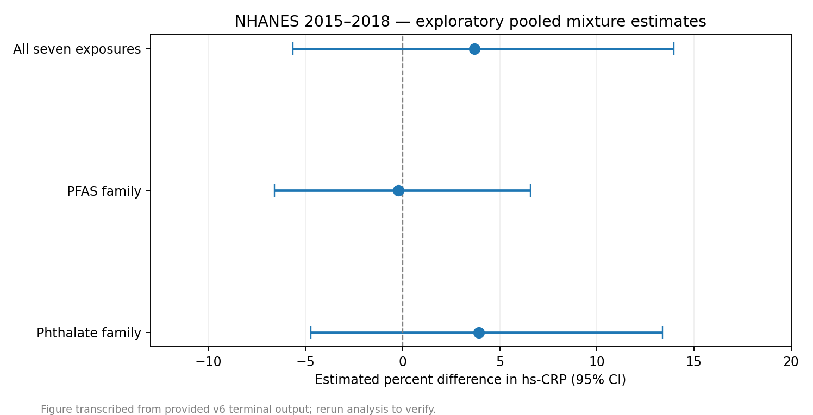
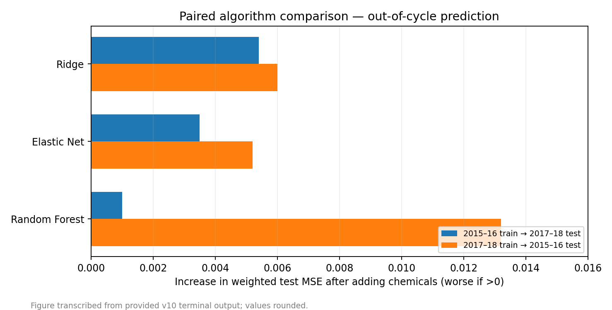

# Environmental Exposomics & Chemical Mixture Modeling — NHANES 2015–2018

**Reproducible exploratory research workflow** · Python · R (`survey`) · SQLite · EPA ToxCast

This repository studies associations between **four serum PFAS biomarkers** and **three urinary phthalate metabolites** and the inflammation marker **hs-CRP** using public CDC NHANES 2015–2018 data. It demonstrates environmental exposome profiling, complex-survey epidemiology, additive quantile-based mixture analysis, robustness checks, out-of-cycle machine-learning evaluation, and exploratory ToxCast assay-evidence integration.

**Not a cancer study.** No claim of a causal link or a confirmed human toxicity mechanism is made. The chemical measurements analyzed here are targeted NHANES laboratory biomarker results, **not raw untargeted LC–HRMS/GC–HRMS processing**.

## At a glance

| Item | Scope / outcome (from supplied local run logs) |
|---|---|
| Years | NHANES 2015–2016 and 2017–2018 |
| Participants | 2,784 pooled complete cases; 2,568 primary (hs-CRP ≤10 mg/L) |
| Exposures | PFHxS, PFNA, PFOA, PFOS, MBP, MEP, MiBP |
| Primary mixture | +3.69% hs-CRP; 95% CI −5.66% to +13.97%; p=0.420 |
| Single chemical | MBP +5.25% per doubling, nominal p=0.018; **FDR p=0.127** |
| Predictive value | No cross-cycle MSE improvement in six paired tests after adding chemicals |
| ToxCast bridge | 170/308 chemical–endpoint pairs recorded in queried source; 52 pairs with screening-positive source records, subject to QC |





> **Data availability & reproducibility:** The numbers above reproduce user-supplied terminal logs; they are *not* re-calculated from the original raw data in this packaged repository. Download the original datasets and run the scripts to confirm them. See [recorded results](docs/RESULTS_FROM_USER_RUNS.md) and [methodological limitations](docs/DATA_SOURCES_AND_LIMITATIONS.md).

## Quickstart on Linux Mint / Ubuntu

```bash
sudo apt update
sudo apt install -y python3-venv python3-pip r-base r-cran-survey
python3 -m venv .venv
.venv/bin/python -m pip install --upgrade pip
.venv/bin/python -m pip install -r requirements.txt

# No local input data required: downloads CDC XPT data, creates a pooled CSV and SQLite DB
.venv/bin/python 10_test_pooled_builder_offline.py
.venv/bin/python 08_build_pooled_2015_2018.py
Rscript 09_pooled_survey_mixture.R
```

Outputs are saved under `data/` and `results/` **locally** and are intentionally not committed to Git.

### Additional analysis modules (run after the pooled builder)

```bash
Rscript 11_cycle_consistency.R                       # 2015–16 vs 2017–18 estimates
.venv/bin/python 13_v8_preflight.py
Rscript 12_creatinine_robustness_splines.R            # dilution, robustness, splines
.venv/bin/python 15_v9_exposure_atlas.py              # co-exposure atlas
.venv/bin/python 18_v10_paired_transfer.py            # matched ML models, train/test cross-cycle
```

### Optional mechanistic screening bridge

This branch requires additional EPA data downloads and, for live v15 querying, an independently maintained **third-party mirror**:

```bash
.venv/bin/python -m pip install -r requirements-toxcast.txt
.venv/bin/python 20_v11_epa_toxcast_bridge.py       # official cytotoxicity table
.venv/bin/python 23_v12_mechanistic_toxcast.py      # official assay/target annotations
.venv/bin/python 25_v13_audit_assay_candidates.py
.venv/bin/python 27_v14_curate_and_bridge.py
.venv/bin/python 29_v15_fetch_bioactivity.py       # third-party mirror; internet required
.venv/bin/python 31_v16_mechanistic_evidence_audit.py
.venv/bin/python 33_v17_prioritize_screening_hits.py
.venv/bin/python 35_v18_quality_evidence.py
.venv/bin/python 37_v19_flag_taxonomy.py
.venv/bin/python 39_v20_decode_numeric_flags.py   # numeric EPA MC6 flag decoder
```

The mirror-derived hitcalls must be validated against official EPA files and curve-quality metadata before any mechanistic interpretation. If a stage has not produced its inputs yet, subsequent stages cannot run. Inspect each stage's historical note in [`docs/version_notes/`](docs/version_notes/).

## Project structure

```text
.
├── 01_download_build.py .. 40_v20_tests.py  # historical modules, tests, and versioned extensions
├── 08_build_pooled_2015_2018.py          # primary CDC pooled-data builder
├── 09_pooled_survey_mixture.R             # primary weighted epidemiology/mixture results
├── 18_v10_paired_transfer.py              # paired out-of-cycle ML models
├── 20_v11_epa_toxcast_bridge.py           # exact chemical-ID cytotoxicity linkage
├── 39_v20_decode_numeric_flags.py        # quality-flag decoding (requires v18 data)
├── data/                                  # ignored raw and derived data
├── results/                               # ignored figures, reports, results and audit logs
├── docs/                                   # results/transparency and historical notes
├── requirements.txt                        # main Python dependencies
├── requirements-toxcast.txt                # optional third-party mirror integration
└── .github/workflows/                       # offline smoke tests
```

Scripts are deliberately retained under their historical numeric names so commands used throughout the research workflow keep working. The 2017–2018-only modules (`01`–`07`, especially the full 18-parameter joint model) are retained for traceability; **use the pooled `08`/`09` analysis as the primary analysis**.

## Methods and transparent findings

- **Exposome:** survey-weighted descriptive chemical distributions; limits of detection and co-exposure correlations.
- **Epidemiology:** survey-weighted hs-CRP models, relevant confounder adjustment, and Benjamini–Hochberg multiple-testing correction.
- **Mixture:** additive quantile-based joint association estimates with 95% confidence intervals.
- **Robustness:** cycle interaction, urinary creatinine adjustment, high-CRP restrictions, winsorization, and restricted cubic splines; post-hoc checks are **not independent replications**.
- **Prediction:** matched baseline-versus-chemical versions of Ridge, Elastic Net, and Random Forest, evaluated on the opposite NHANES cycle.
- **Mechanistic context:** exact-CAS matched cytotoxicity and assay annotations; screening positives and missing coverage are distinguished. This is hypothesis-generating evidence only.

**Important:** the original nominal MBP association **does not remain significant after FDR correction**; the primary seven-chemical mixture was not statistically significant. Do not optimize feature choices to manufacture p <0.05.

## Data sources, attribution and usage

- [CDC NHANES](https://wwwn.cdc.gov/nchs/nhanes/) — 2015–2016 and 2017–2018 survey and laboratory data.
- [US EPA ToxCast](https://www.epa.gov/comptox-tools/exploring-toxcast-data) — invitrodb assay annotations, cytotoxicity, and activity models.
- [`scigantic-comptox`](https://pypi.org/project/scigantic-comptox/) — optional third-party access to a screening-data mirror; **not** an official EPA API.

The code is MIT-licensed. The license does **not** transfer ownership or license the underlying CDC/EPA/mirror data. Before public release, review your author/attribution information in `LICENSE` and `CITATION.cff`.

## Reproducing tests

```bash
.venv/bin/python 07_test_zero_handling.py
.venv/bin/python 10_test_pooled_builder_offline.py
.venv/bin/python 14_v8_offline_math_tests.py
.venv/bin/python 19_v10_synthetic_tests.py
.venv/bin/python 40_v20_tests.py
```

All local synthetic tests exercise program logic, **not the validity of scientific inferences or API results**.

## Scope and future work

Official EPA curve/flag verification, assay-level concentration range checks, NHANES survey-methods expert review, and fully documented exposure–outcome DAG are priorities before academic publication. The project is a *portfolio research workflow*, not a peer-reviewed publication.
